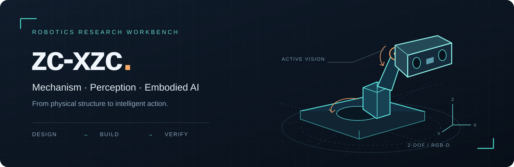
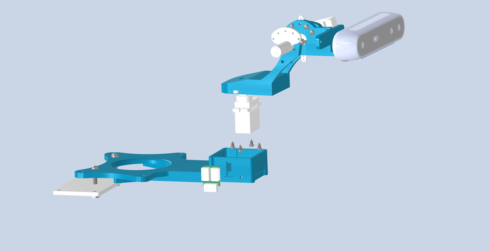
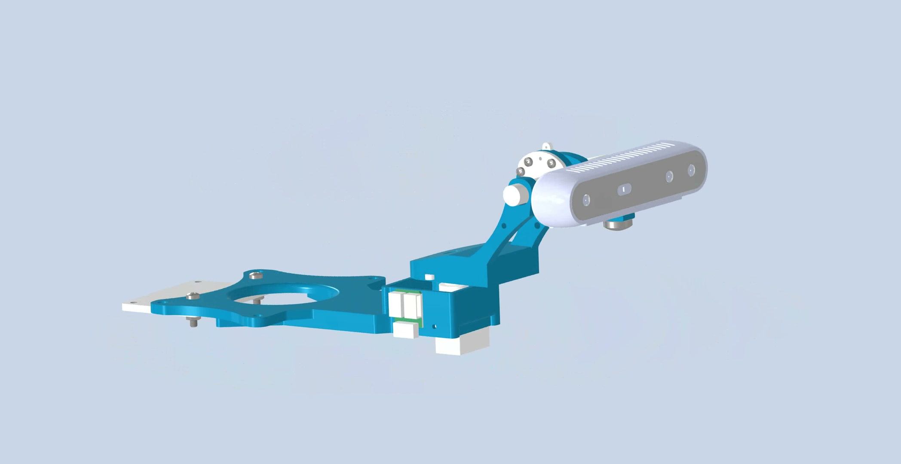
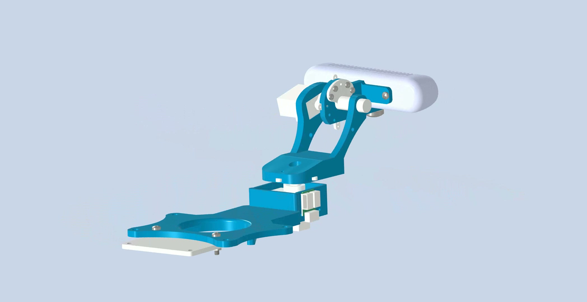

<picture>
  <source media="(max-width: 600px)" srcset="./assets/workbench-cover-mobile.svg">
  
</picture>

# 许子成 · Zicheng Xu

**机器人机构设计 · 视觉感知 · 具身智能**

围绕**机构与算法协同**，把研究问题转化为可查看的模型、代码和实验方案。这里展示工程项目、研究设计与学习资料，同时说明每个项目的来源、公开内容与验证阶段。

*Working across robot mechanisms, visual perception, and embodied AI.*

[精选作品](#精选作品) · [学习与工具](#学习与工具) · [研究方案](#研究与技术方案) · [更多项目](#更多工程与笔记) · [全部仓库](https://github.com/zc-xzc?tab=repositories) · [联系](#联系)

| 从机构出发 | 让流程可验证 | 让概念可交互 |
| :--- | :--- | :--- |
| [主动视觉平台](https://github.com/zc-xzc/robot_platform) | [OpenReal2Sim 复现工程](https://github.com/zc-xzc/openreal2sim-reproduction-showcase) | [MathViz 在线体验 ↗](https://zc-xzc.github.io/MathViz/) |
| 机械设计 → 姿态映射 → 云台控制 | 来源锁定 → 分阶段执行 → 证据检查 | 方程参数 → 三维结构 → 几何理解 |

## 精选作品

*Star 徽章自动获取数据，缓存可能造成延迟；实时数量以仓库页面为准。封面为基于云台外形的示意设计，下方 CAD 图来自项目资产。*

### 01 · 主动视觉平台 / robot_platform

**工程代码与硬件设计资产 · 头部追踪 / 两自由度云台 / RGB-D 视觉**

面向人形机器人遥操作场景，将 **PICO 4 头部姿态 → STS3032 两轴云台 → RealSense D415 相机视角** 串联起来，让操作者的视线变化与机器人摄像头朝向关联。

- **控制与感知：** Windows / Linux Python 入口，姿态映射、PD 控制、标定与诊断工具。
- **机械与仿真：** STEP / STL 结构文件、BOM、装配说明，以及 URDF / MuJoCo（MJCF）模型资产。
- **使用边界：** 真机运行需要对应硬件和 PicoBridge 组件；模型可动性与使用方法以各目录说明为准。

<table>
  <tr>
    <td width="33%" align="center"> 结构分解 · CAD 渲染</td>
    <td width="34%" align="center"> 总装视图 · CAD 渲染</td>
    <td width="33%" align="center"> 侧向结构 · CAD 渲染</td>
  </tr>
</table>

[项目总览](https://github.com/zc-xzc/robot_platform) · [中文运行说明](https://github.com/zc-xzc/robot_platform/blob/main/active_vision_dist/README_CN.md) · [机械安装教程](https://github.com/zc-xzc/robot_platform/blob/main/3d_print_parts/avp_model/docs/installation_mechanical.md) · [物料清单](https://github.com/zc-xzc/robot_platform/blob/main/3d_print_parts/avp_model/bom/avp_model_BOM.xlsx)

### 02 · OpenReal2Sim / 复现工程与验证

**研究复现辅助工具 · 来源锁定 / 安全入口 / 分阶段验收**

围绕 [PointsCoder/OpenReal2Sim](https://github.com/PointsCoder/OpenReal2Sim) 整理独立展示仓库，将公开源码来源、执行步骤、产物检查和验证证据串联起来，便于判断每个阶段做了什么、还缺什么。

- **工程内容：** 固定上游版本与直接子模块，提供默认只输出计划的执行辅助工具、4 文件安全补丁、路径与资产校验，以及中文执行和排错手册。
- **已验证范围：** 70 项合成 CPU 工具测试及静态检查；对应自动检查见[验证记录](https://github.com/zc-xzc/openreal2sim-reproduction-showcase/actions/runs/42449638043)。结构检查通过不等于重建质量或物理结果合格。
- **贡献与边界：** 上游模型和重建算法不计为原创。GPU 端到端、完整环境与模型锁、真实输入、标注、视频及仿真仍未验证，不能称为完整或离线一键复现。

[项目总览](https://github.com/zc-xzc/openreal2sim-reproduction-showcase) · [执行手册](https://github.com/zc-xzc/openreal2sim-reproduction-showcase/blob/main/docs/execution-runbook.zh-CN.md) · [验证状态](https://github.com/zc-xzc/openreal2sim-reproduction-showcase/blob/main/docs/verification-status.zh-CN.md) · [贡献与归属](https://github.com/zc-xzc/openreal2sim-reproduction-showcase/blob/main/docs/contribution-audit.zh-CN.md)

### 03 · MathViz / 让数学看得见

**浏览器交互作品 · 线性代数可视化**

把抽象数学概念转成可以观察和操作的空间结构。当前核心模块是 **3×3 线性方程组三维求解器**：输入矩阵与方程参数，观察解集的几何形态，理解“非齐次通解 = 特解 + 齐次通解”。

当前以这一线性代数模块为主；其他数学专题仍在规划。可直接在浏览器体验，或从仓库查看页面源码与模块说明。

[在线体验](https://zc-xzc.github.io/MathViz/) · [打开三维求解器](https://zc-xzc.github.io/MathViz/线性代数/非齐次解三维演示/) · [项目与使用说明](https://github.com/zc-xzc/MathViz)

## 学习与工具

学习路线、视觉代码与科研自动化工具。展开查看内容、使用方式与来源。

### 具身智能学习手册 / embodied-ai-learning-handbook

查看内容、使用方式与来源

**学习资料与资源整理 · 从基础理论到研究方向**

按主题组织具身智能知识与公开资源，帮助学习者建立连贯的学习路线。内容涵盖视觉-语言-动作模型（VLA）、模仿学习、强化学习、遥操作、仿真、Sim2Real、数据采集与主动视觉。

- **如何使用：** 先确定学习路径，再按专题阅读基础概念、论文和工具资料。
- **可以找到：** 理论笔记、论文导读、MuJoCo / Isaac Lab 等仿真资源，以及 ALOHA / UMI 等遥操作资料。
- **来源与许可：** 参考 Embodied-AI-Guide、Xbotics-Embodied-Guide 等社区资料整理，详见[致谢](https://github.com/zc-xzc/embodied-ai-learning-handbook/blob/main/ACKNOWLEDGMENTS.md)；使用时遵循仓库标注的 CC BY-NC-SA 4.0 及引用资源许可。

[手册首页](https://github.com/zc-xzc/embodied-ai-learning-handbook) · [学习路径](https://github.com/zc-xzc/embodied-ai-learning-handbook/blob/main/00-总览与学习路径/00.2-学习路径规划.md) · [资源导航](https://github.com/zc-xzc/embodied-ai-learning-handbook/blob/main/00-总览与学习路径/00.3-资源导航地图.md) · [主动视觉专题](https://github.com/zc-xzc/embodied-ai-learning-handbook/blob/main/12-主动视觉专项/12.1-主动视觉技术全景与论文综述.md)

### 双目三维重建 / Stereo 3D Reconstruction

查看内容、使用方式与来源

**视觉代码集成 · 标定 / 深度估计 / 三维重建**

围绕双目相机的空间感知流程，组织相机标定、立体校正与匹配、视差和深度计算、点云重建，以及手眼标定与坐标转换相关代码。

- **可查看内容：** 重建流程与自定义算法目录、标定工具、数据增强与可视化材料、YOLOv12 集成代码。
- **技术重点：** 从二维图像建立空间几何关系，为测距、定位与机器人视觉应用提供代码参考。
- **复用说明：** 仓库包含第三方组件，使用前需查看各组件许可与来源说明。

[项目与目录说明](https://github.com/zc-xzc/Dual-eye-three-dimensional-reconstruction-system) · [重建流程](https://github.com/zc-xzc/Dual-eye-three-dimensional-reconstruction-system/tree/main/stereo_reconstruction_working) · [第三方说明](https://github.com/zc-xzc/Dual-eye-three-dimensional-reconstruction-system/blob/main/THIRD_PARTY_NOTICES.md)

### academic-tools / 科研与文件处理工具箱

查看内容、使用方式与来源

**Python 工具集 · 文本分析 / 批量处理 / 工作流整理**

把重复的科研资料处理工作整理为脚本与说明，包括政策文本要素提取、描述性统计、文件合并与重命名、PDF 整理和视频抽帧。

- **输入与输出：** 面向已有文件或文本目录进行处理；政策统计脚本可生成 Markdown 报告与图表。
- **使用方式：** 按模块选择工具，配置输入输出路径与依赖，不依赖统一应用界面。
- **扩展内容：** 另收录科研与效率相关的技能定义、流程文档；第三方材料保留来源和许可说明。

[工具总览](https://github.com/zc-xzc/academic-tools) · [政策统计脚本](https://github.com/zc-xzc/academic-tools/blob/main/classification/policy/policy_stats.py) · [文件处理](https://github.com/zc-xzc/academic-tools/tree/main/file_utils) · [来源与许可](https://github.com/zc-xzc/academic-tools/blob/main/THIRD_PARTY_NOTICES.md)

## 研究与技术方案

以下为研究与设计阶段项目，与工程实现、实验结果分开呈现。

采后水果处理智能框架 / postharvest-agent-framework

**阶段：概念研究设计。当前公开框架图与设计说明，尚无实现代码、数据集或实验结果。**

围绕水果采后处理，设计“感知 → 品质推断 → 任务规划 → 安全门控操作 → 追溯审计”的闭环。监督智能体用于检索、推理和动作提议，不直接驱动电机；设计中保留力、速度和工作空间约束。

验证方案包括独立批次、人工核验、跨批次与光照变化，以及 B0–B3 对照实验，用于检验约束规划与闭环审计是否带来实际改进。

[项目说明](https://github.com/zc-xzc/postharvest-agent-framework) · [框架图](https://github.com/zc-xzc/postharvest-agent-framework/blob/main/figures/postharvest_agent_framework_en.svg) · [设计与验证方案](https://github.com/zc-xzc/postharvest-agent-framework/blob/main/docs/framework-overview.md)

无人机单张纸页投放装置 / uav-leaflet-dispenser

**阶段：技术方案与文档设计。包含专利交底书源稿，不表示已获专利授权。**

提出无人机挂载式单张纸页分离投放方案，围绕搓纸分离、出纸快门、导纸通道与控制模式展开机械和电控设计。

已公开需求规格、总体方案、研制计划、测试验收方案及专利交底稿；仓库尚未提供 CAD、固件、样机照片或实测结果。文档中的性能指标属于设计与验收目标。

[项目总览](https://github.com/zc-xzc/uav-leaflet-dispenser) · [总体技术方案](https://github.com/zc-xzc/uav-leaflet-dispenser/blob/main/03_总体技术方案设计.md) · [测试与验收方案](https://github.com/zc-xzc/uav-leaflet-dispenser/blob/main/06_测试与验收方案.md)

## 更多工程与笔记

| 项目 | 公开内容与定位 |
| --- | --- |
| [Water_robot · 水下机器人](https://github.com/zc-xzc/Water_robot) | 双目视觉、Jetson / TensorRT 部署与 FSI-FNO 建模代码的集成仓库；包含第三方组件。 |
| [AI-Vision · 视觉工具](https://github.com/zc-xzc/AI-Vision) | TensorFlow Lite 检测、识别训练、相机配置与串口工具；部分教程和模型资产的来源仍待核验。 |
| [ros · 机器人开发环境](https://github.com/zc-xzc/ros) | ROS Docker 启动脚本、机械臂与夹爪 URDF、RViz / Gazebo 配置及操作说明。 |
| [embodied-intelligence · 研究方向日志](https://github.com/zc-xzc/embodied-intelligence) | 力反馈遥操作、主动视觉、人形机器人全身控制等方向的调研、技术空白与开放问题。 |
| [fsi-coatings · 数值模拟笔记](https://github.com/zc-xzc/fsi-coatings) | 流固耦合与涂层耐久性学习记录，包含文献笔记、FEniCS 教程和数据分析脚本。 |
| [ai-biopharma-notes · AI × 药物发现](https://github.com/zc-xzc/ai-biopharma-notes) | 基于公开来源的学习笔记，附 ChEMBL 检索与 RDKit 结构归一化示例；不代表药物研发实验成果。 |

## 开源复用与参考

以下仓库是上游项目的 Fork 或基于上游代码的整理，单独列出以明确来源。具体改动与使用许可请查看各仓库。

| 仓库 | 来源与用途 |
| --- | --- |
| [SO-ARM100](https://github.com/zc-xzc/SO-ARM100) | Fork 自 [TheRobotStudio/SO-ARM100](https://github.com/TheRobotStudio/SO-ARM100)，低成本 SO-100 / SO-101 机械臂、装配与遥操作资料。 |
| [HandEye-Tsai](https://github.com/zc-xzc/HandEye-Tsai) | Fork 自 [LarryDong/HandEye-Tsai](https://github.com/LarryDong/HandEye-Tsai)，Tsai 手眼标定的 MATLAB 实现与示例。 |
| [Docker-Localization](https://github.com/zc-xzc/Docker-Localization) | Fork 自 [tech-shrimp/docker_image_pusher](https://github.com/tech-shrimp/docker_image_pusher)，通过 GitHub Actions 同步容器镜像。 |
| [midea-local](https://github.com/zc-xzc/midea-local) | Fork 自 [midea-lan/midea-local](https://github.com/midea-lan/midea-local)，美的 M-Smart 设备局域网控制。 |
| [yolov5-master](https://github.com/zc-xzc/yolov5-master) | 基于 [Ultralytics YOLOv5](https://github.com/ultralytics/yolov5) 的代码与环境整理，保留上游框架归属。 |

## 技术领域

按项目中的实际用途整理，便于快速找到相关工作。

| 领域 | 技术与对应实践 |
| --- | --- |
| 机械设计与系统集成 | CAD、STEP / STL、3D 打印、BOM、装配设计；见主动视觉平台。 |
| 机器人控制与仿真 | Python、PD 控制、ROS、URDF、MuJoCo / MJCF；见云台控制与 ROS 环境。 |
| 视觉感知与部署 | OpenCV、双目标定与重建、RealSense、YOLO、TensorRT / TFLite；见视觉相关仓库。 |
| 科研计算与自动化 | Python、PyTorch、MATLAB、FEniCS、Git / Docker；用于建模、资料处理与研究复现。 |

## 联系

**邮箱：** [xzc18155121449@163.com](mailto:xzc18155121449@163.com) 
**视频与动态：** [Bilibili · 1664940404](https://space.bilibili.com/1664940404) 
**代码与文档：** [github.com/zc-xzc](https://github.com/zc-xzc)

具体项目问题也可在对应仓库的 Issues 中交流。引用或复用时，请以各仓库及其第三方组件的许可为准。

